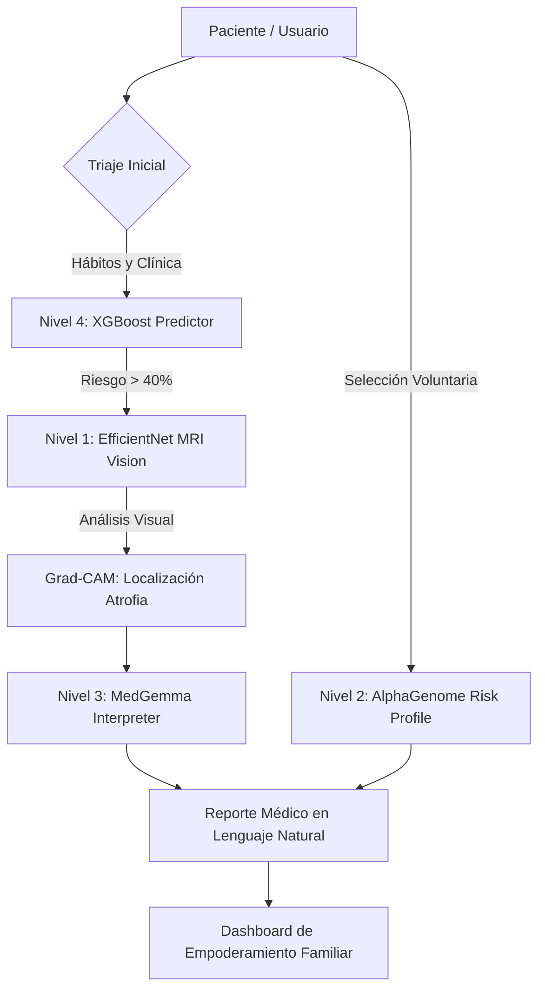

# 🧠 Perdix Vision — AlzheimerAI
> **"Democratizando el diagnóstico neurológico de precisión para que nadie pierda su identidad por falta de acceso."**

---

## 🌟 Nuestra Misión (Sinceridad y Propósito)
En muchos países como el mío, el Alzheimer no es solo una enfermedad degenerativa; es una condena silenciosa agravada por la falta de recursos. Mientras que en el mundo desarrollado se habla de curas experimentales, en nuestras regiones el **75% de las personas nunca reciben un diagnóstico a tiempo**.

**Perdix Vision** nace de una experiencia personal. No es solo software; es un sistema de 4 niveles diseñado para intervenir en cada etapa del camino del paciente, desde antes de los síntomas hasta el reporte clínico final.

---

## 🏗️ Arquitectura Técnica y Flujo de Datos

Perdix Vision integra cuatro capas de procesamiento para una precisión diagnóstica superior:

### 🔴 Nivel 1: Clasificación MRI Vision
- **Modelo**: EfficientNetB0 (Transfer Learning) + Fine-tuning.
- **Función**: Clasificación automática (Sano, Muy Leve, Leve, Moderado).
- **IA Explicable (XAI)**: Visualización Grad-CAM para validar la atrofia del hipocampo.

### 🧬 Nivel 2: Genómica Predictiva (AlphaGenome)
- **Concepto**: Basado en arquitecturas de Google DeepMind.
- **Análisis**: Perfilado de riesgo poligénico (PRS) para detección pre-sintomática.

### 🏥 Nivel 3: Interpretación Clínica (MedGemma)
- **Modelo**: MedGemma 4B de Google Health.
- **Salida**: Reportes HL7-ready que explican la neurodegeneración al médico no especialista.

### 📊 Nivel 4: Predicción por Estilo de Vida
- **Modelo**: XGBoost entrenado con 74K registros.
- **Precisión 2026**: Integra la **Dieta MIND** y la **Cetogénica Terapéutica** como intervenciones personalizadas sugeridas por la IA.

---

## 🇪🇨 Validación Local e Impacto 2026

Perdix Vision está diseñado para el ecosistema de salud de Ecuador:
- **Alianzas Institucionales**: Diseñado para pilotos en el **Hospital Luis Vernaza** y el **Instituto de Neurociencias** (Guayaquil).
- **Biomarcadores p-tau217**: Integración conceptual con los nuevos test de sangre de 2026 como confirmación definitiva.
- **Triaje en el IESS**: Reducción de listas de espera de neurología mediante el filtrado inteligente de casos preventivos.

---

## 🖤 Impacto Humano y Ético
- **Empathy-First UI**: Diseño de dashboards que reducen la ansiedad familiar y la carga cognitiva del médico.
- **Ahorro Social**: Estimamos un ahorro de **$64,000 USD** por paciente gracias a la detección temprana.
- **Justicia Algorítmica**: Modelos entrenados con diversidad de datos para evitar sesgos en poblaciones latinoamericanas.

---
*Dedicado a todas las familias que luchan contra el olvido.*
**Perdix Vision 2026 — Erick Zambrano**
